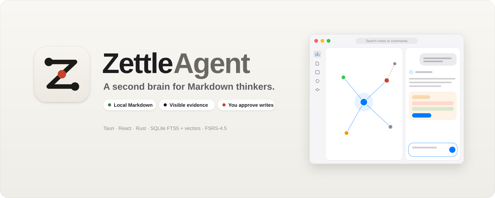
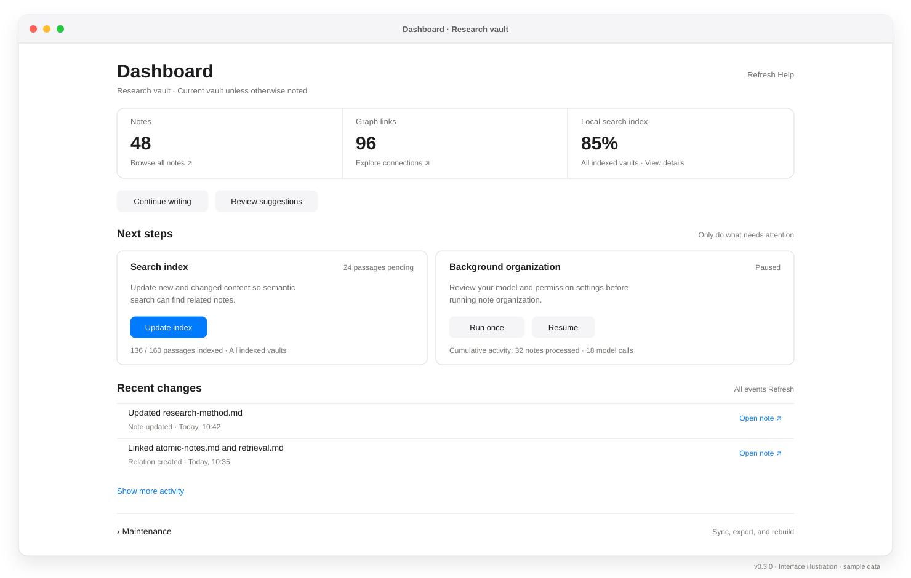
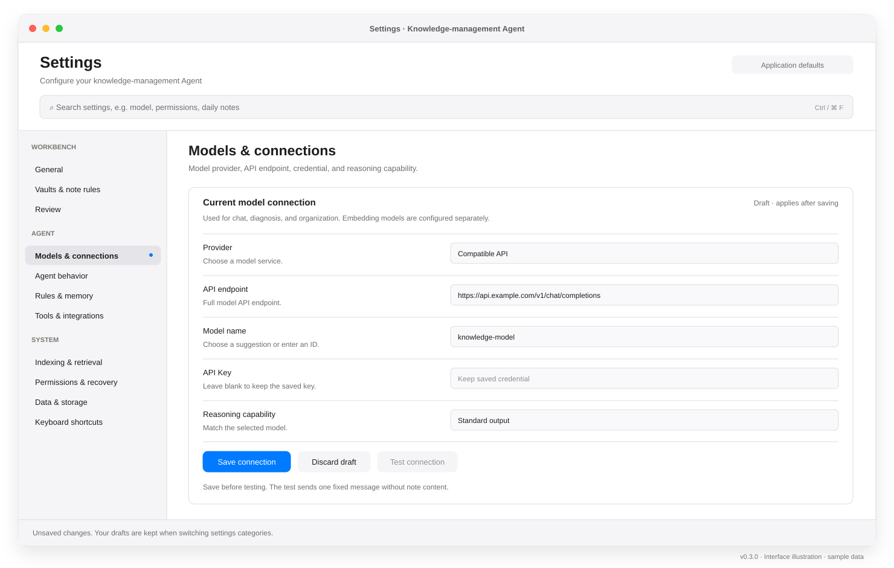
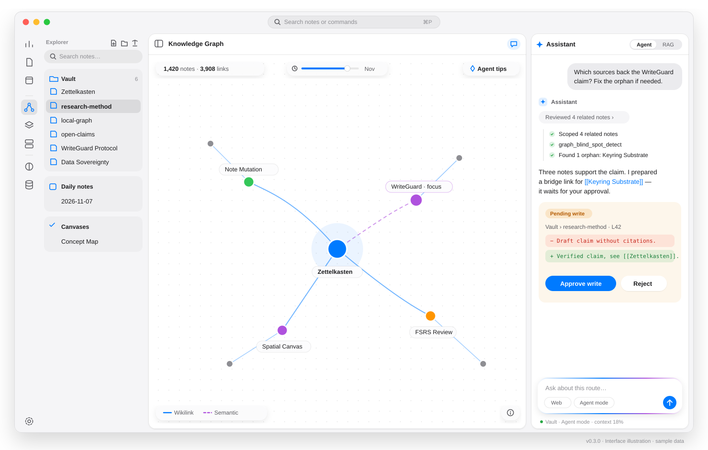
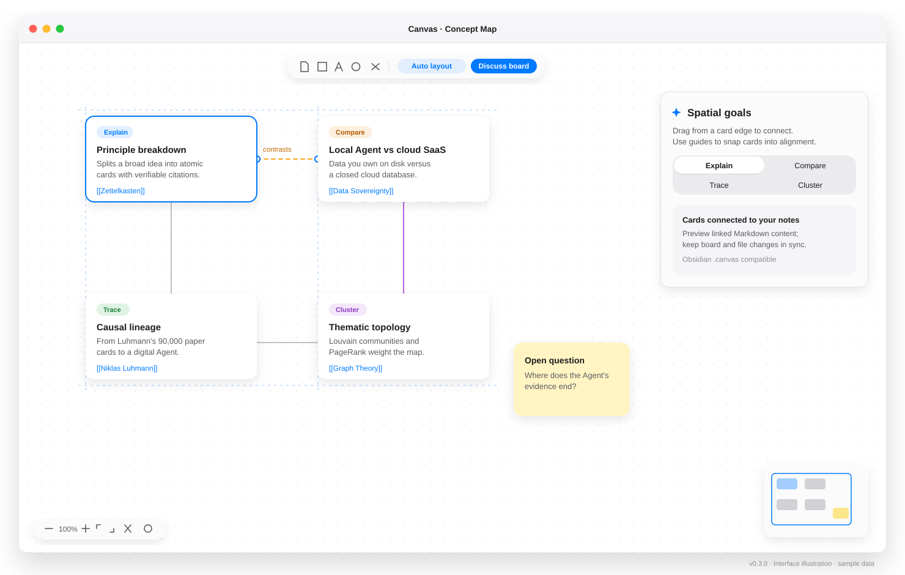
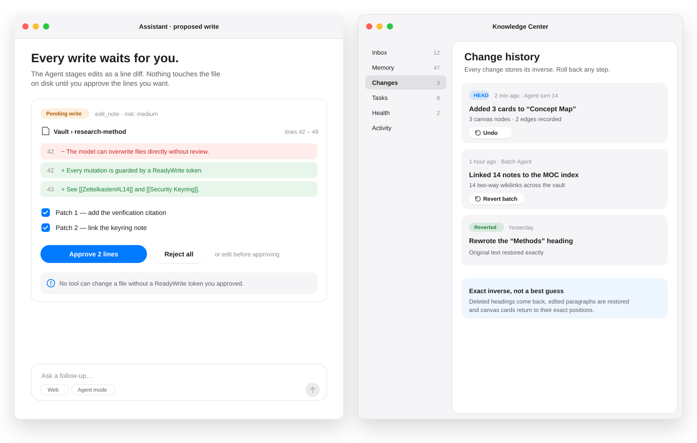
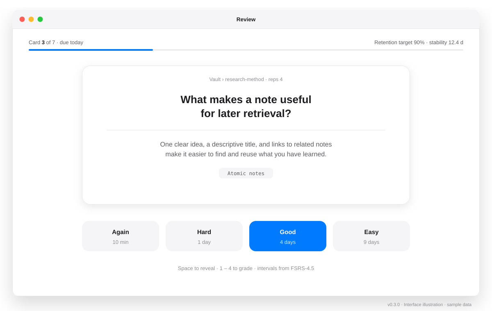

# ZettelAgent

### A local-first AI Agent / IDE for knowledge management

Write in Markdown. Find related ideas. Review what your Agent changes.

ZettelAgent brings notes, retrieval, a knowledge graph, an infinite canvas, and spaced repetition into one desktop workbench. Connect a local or cloud language model for conversations, diagnosis, and note organization.

[](https://github.com/Poetrynan/ZettleAgent/releases)


[](https://github.com/Poetrynan/ZettleAgent/blob/master/LICENSE)

**English** · [中文](README_CN.md) · [日本語](README_JP.md) · [한국어](README_KR.md)

[Releases](https://github.com/Poetrynan/ZettleAgent/releases) · [Website](https://poetrynan.github.io/zettelagent.org/) · [v0.3.0 Release Notes](.github/release-notes/v0.3.0.md)

[What is new](#new) · [Capabilities](#features) · [Interface guide](#showcase) · [Quick start](#start) · [Build from source](#build) · [Platforms](#platforms) · [Contributing](#contributing)

<a id="new"></a>

## What is new — v0.3.0

v0.3.0 focuses on the knowledge-management workbench: a task-oriented Dashboard, 11 searchable settings sections, improved canvas connections and snapping, Chinese search, and stronger history and undo handling.

<a id="features"></a>

## Capabilities

| Workflow | What you can do |
| :--- | :--- |
| **Markdown vaults** | Use local folders, daily notes, wikilinks, and unlinked mentions. Keep your note files accessible outside the app. |
| **Dashboard** | See vault counts, indexing progress, background organization, recent changes, and knowledge diagnostics. Keep maintenance actions out of the everyday path. |
| **Agent and knowledge center** | Ask questions with retrieved context; inspect proposed changes, memories, tasks, and graph-gap plans. Connect external MCP tools and skill directories. |
| **Hybrid retrieval** | Combine FTS5 keyword search, local 768-dimensional Jina embeddings, graph signals, and BCE reranking. Match Simplified and Traditional Chinese and exclude content with `.zettelignore`. |
| **Canvas and graph** | Connect and align cards with snapping guides; use explain, compare, trace, and cluster plans. Explore graph links, PageRank, and communities; work with Obsidian `.canvas` files. |
| **Settings workbench** | Search 11 sections under Workbench, Agent, and System. Test saved model connections, keep drafts across categories, and configure rules, permissions, retrieval, and storage. |
| **Review** | Use FSRS-4.5 review scheduling with configurable retention, daily limits, and maximum intervals. |
| **Change review and recovery** | Inspect supported Agent mutations through permission checks, previews, and change history. Undo checks for later edits and can refuse a conflicting restoration. |

### Local data and model connections

Notes, the search database, and bundled embedding / OCR processing stay local. AI chat and organization require a model connection: a cloud provider receives the request and the note context included in it; a local service can keep those requests on your machine. A custom remote embedding service also receives the text sent for indexing and search. External tools follow their own connections.

API keys use the OS credential store when available. If it is unavailable, Settings reports an unprotected fallback. Check **Permissions & recovery** before enabling automation: approval requirements depend on the permission mode. An undo history is not a substitute for a backup.

<a id="showcase"></a>

## Interface guide

These SVGs are interface illustrations with sample data, not captured screenshots. They show workflows and information hierarchy; appearance varies by theme and platform.

### 1. Dashboard — status, next steps, indexing, and recent changes



### 2. Settings — search, grouped navigation, and an explicit connection draft



### 3. Workspace — explorer, graph, and Agent conversation



### 4. Canvas — note cards, connections, and alignment guides



### 5. Change review — proposed edits and conflict-aware recovery



### 6. Review — recall and FSRS scheduling



<a id="start"></a>

## Quick start

1. Download a package for your platform from [Releases](https://github.com/Poetrynan/ZettleAgent/releases) and install it. Node.js and Docker are not required for the installed app.
2. Open a local Markdown folder as a vault.
3. Open Dashboard and update the search index. The bundled model loads on demand, so first use may take a moment.
4. For AI chat and organization, open **Settings → Models & connections**, choose a provider, save the connection, and test it. A chat model is not bundled with the app.
5. Review **Agent behavior**, **Rules & memory**, and **Permissions & recovery** before running automated organization.

The vector index uses **768 dimensions**. Custom embedding services must return that size. Updating the index processes pending content; **Rebuild all vectors** clears derived vectors and caches before regenerating them. Remote services incur new requests. Pause background organization before a full rebuild.

<a id="build"></a>

## Build from source

Use Node.js **20.19+ or 22.12+**, Rust stable, and the Tauri build prerequisites for your platform. Linux build dependencies are listed in [the release workflow](.github/workflows/release.yml).

```bash
git clone https://github.com/Poetrynan/ZettleAgent.git
cd ZettleAgent
npm ci
npm run download-model
npm run tauri dev
```

```bash
npm test -- --maxWorkers=4
npm run build
npm run tauri build
```

The production build downloads embedding, reranking, WASM, font, and PDF assets and bundles the offline resources. Source builds require network access during preparation. Tauri generates `src-tauri/gen/` on first use.

<a id="platforms"></a>

## Platforms

The release workflow targets the following platforms. Available packages and sizes are listed with the actual release assets; no fixed installer size is promised.

| Platform | Architecture | Packages |
| :--- | :--- | :--- |
| Windows | x64 | `.exe`, `.msi` |
| macOS | Apple Silicon / Intel | `.dmg` |
| Linux | x64 | `.AppImage`, `.deb` |

<a id="contributing"></a>

## Contributing

See [CONTRIBUTING.md](CONTRIBUTING.md) for contribution guidance. Bug reports are most useful with the app version, platform, reproduction steps, and relevant redacted logs.

Built with Tauri, React, Rust, SQLite / sqlite-vec, Jina embeddings, BCE reranking, and FSRS; inspired by Zettelkasten and local Markdown workflows.

Licensed under [Apache License 2.0](LICENSE).
