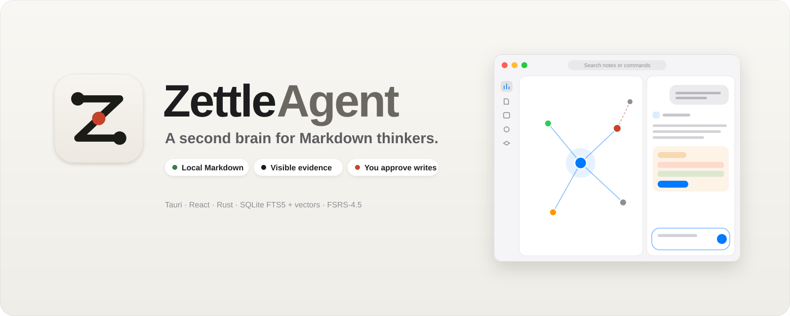
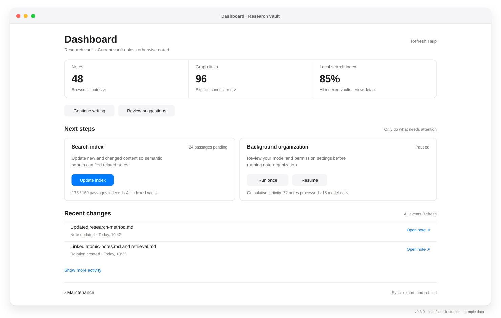
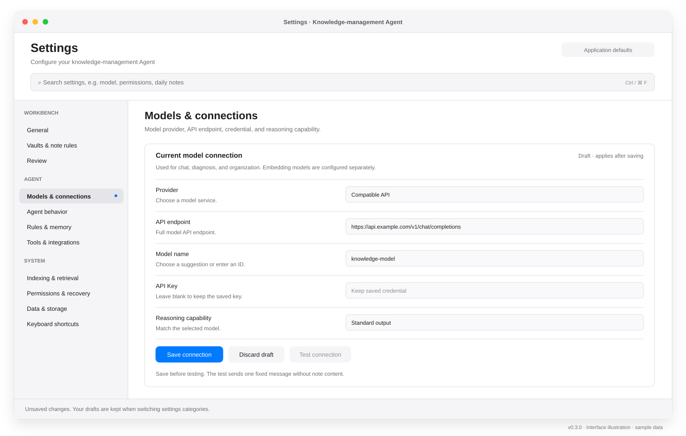
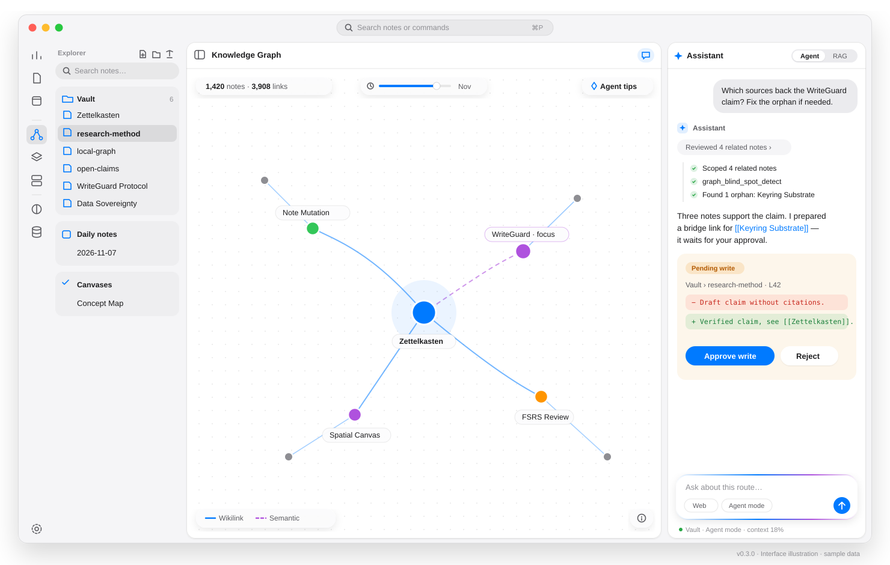
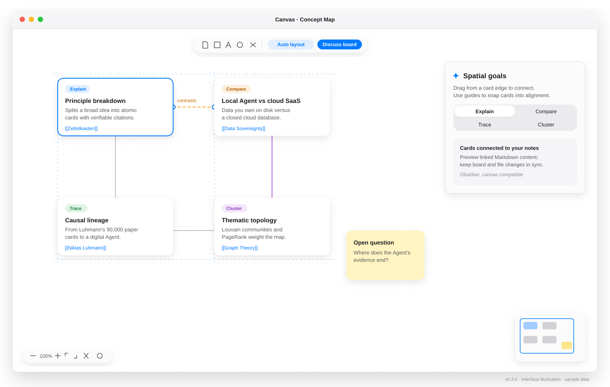
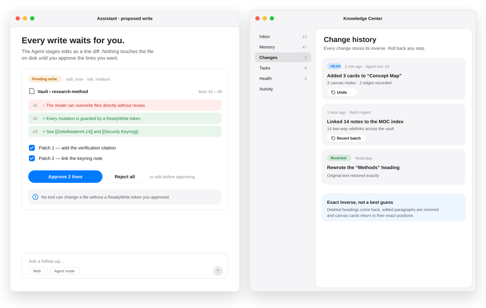
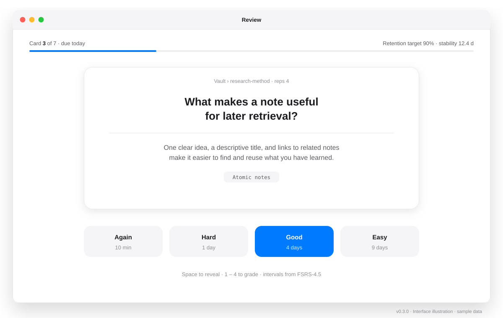

# ZettelAgent

### 专为知识管理打造的本地优先 AI Agent / IDE

用 Markdown 写作，找回相关想法，审查 Agent 的每次重要改动。

ZettelAgent 将笔记、检索、知识图谱、无限白板与间隔复习放进同一个桌面工作台。连接本地或云端语言模型后，可进行对话、知识诊断与笔记整理。

[](https://github.com/Poetrynan/ZettleAgent/releases)


[](https://github.com/Poetrynan/ZettleAgent/blob/master/LICENSE)

[English](README.md) · **中文** · [日本語](README_JP.md) · [한국어](README_KR.md)

[Releases](https://github.com/Poetrynan/ZettleAgent/releases) · [Website](https://poetrynan.github.io/zettelagent.org/) · [v0.3.0 Release Notes](.github/release-notes/v0.3.0.md)

[本次更新](#new) · [核心能力](#features) · [界面导览](#showcase) · [快速开始](#start) · [从源码构建](#build) · [支持平台](#platforms) · [参与贡献](#contributing)

<a id="new"></a>

## 本次更新 — v0.3.0

v0.3.0 围绕知识管理工作台升级：按任务组织的 Dashboard、11 个可搜索的设置分区、白板连线与吸附、中文检索，以及更稳健的历史读取和撤销保护。

<a id="features"></a>

## 核心能力

| 工作流 | 可以做什么 |
| :--- | :--- |
| **Markdown 知识库** | 使用本地文件夹、每日笔记、双向链接与未链接提及，笔记文件也能在其他编辑器中访问。 |
| **Dashboard** | 查看知识库数量、索引进度、后台整理、最近变化与知识诊断；维护操作收起显示。 |
| **Agent 与知识中心** | 基于检索上下文提问，审查变更建议、记忆、任务与图谱盲区计划；连接外部 MCP 工具与技能目录。 |
| **混合检索** | 结合 FTS5 全文搜索、本地 768 维 Jina 嵌入、图谱信号与 BCE 精排；支持简繁互搜和 `.zettelignore` 排除规则。 |
| **白板与图谱** | 拖拽连线、吸附对齐，使用拆解、对比、溯源和聚类计划；查看图谱关联、PageRank 与社群，处理 Obsidian `.canvas` 文件。 |
| **设置工作台** | 在工作台、Agent、系统三组中搜索 11 个分区；测试已保存的模型连接，切换分类保留草稿，配置规则、权限、检索与存储。 |
| **间隔复习** | 基于 FSRS-4.5 安排复习，配置目标保持率、每日任务上限和最长间隔。 |
| **变更审查与恢复** | 支持的 Agent 修改经过权限检查，可查看预览与变更记录；撤销会检查后续编辑，冲突时可能拒绝恢复。 |

### 本地数据与模型连接

笔记、搜索数据库以及内置嵌入和 OCR 处理保存在本地。AI 对话与整理需要模型连接：使用云端服务时，请求及其中包含的笔记上下文会发送给该服务；连接本地模型服务可将这些请求留在本机。自定义远程嵌入服务也会接收用于索引和搜索的文本。外部工具按各自的连接方式工作。

密钥优先存入操作系统凭据库；凭据库不可用时，设置页会显示未受保护的降级存储状态。启用自动整理前，请检查**权限与恢复**：审批要求取决于权限档位。撤销记录不能代替备份。

<a id="showcase"></a>

## 界面导览

以下 SVG 为使用示例数据绘制的界面示意图，并非实际截图，用于说明工作流和信息层级；不同主题与平台的外观可能不同。

### 1. Dashboard：状态、下一步操作、索引与最近变化



### 2. 设置：搜索、分组导航与显式保存的连接草稿



### 3. 工作区：文件浏览器、图谱与 Agent 对话



### 4. 白板：笔记卡片、连线与对齐参考线



### 5. 变更审查：修改建议与避免覆盖后续编辑的恢复



### 6. 复习：主动回忆与 FSRS 计划



<a id="start"></a>

## 快速开始

1. 从 [Releases](https://github.com/Poetrynan/ZettleAgent/releases) 下载对应平台的安装包并安装。安装后的应用无需 Node.js 或 Docker。
2. 打开本地 Markdown 文件夹作为知识库。
3. 在 Dashboard 更新搜索索引。内置模型按需加载，首次使用可能需要等待。
4. 需要 AI 对话和整理时，打开**设置 → 模型与连接**，选择服务、保存并测试连接。应用不内置对话大模型。
5. 自动整理前，先检查 **Agent 行为**、**规则与记忆**和**权限与恢复**。

向量索引固定为 **768 维**，自定义嵌入服务需返回相同维度。“更新索引”处理待索引内容；“全部重建向量”会清除派生向量和缓存再生成。远程服务会产生新的请求；全部重建前请暂停后台整理。

<a id="build"></a>

## 从源码构建

需要 Node.js **20.19+ 或 22.12+**、Rust stable，以及对应平台的 Tauri 构建依赖。Linux 依赖见[发布工作流](.github/workflows/release.yml)。

```bash
git clone https://github.com/Poetrynan/ZettleAgent.git
cd ZettleAgent
npm ci
npm run download-model
npm run tauri dev
```

```bash
npm test -- --maxWorkers=4
npm run build
npm run tauri build
```

生产构建会下载嵌入、精排、WASM、字体与 PDF 资源，并将离线资源打包。源码构建的准备阶段需要联网；首次运行 Tauri 会生成 `src-tauri/gen/`。

<a id="platforms"></a>

## 支持平台

发布流程面向下列平台。实际安装包和体积以各次 Release 附件为准，不承诺固定大小。

| 平台 | 架构 | 安装包 |
| :--- | :--- | :--- |
| Windows | x64 | `.exe`, `.msi` |
| macOS | Apple Silicon / Intel | `.dmg` |
| Linux | x64 | `.AppImage`, `.deb` |

<a id="contributing"></a>

## 参与贡献

参与方式见 [CONTRIBUTING.md](CONTRIBUTING.md)。反馈问题时，请提供版本、平台、复现步骤及已脱敏的相关日志。

基于 Tauri、React、Rust、SQLite / sqlite-vec、Jina 嵌入、BCE 精排和 FSRS 构建，借鉴卡片盒笔记法与本地 Markdown 工作流。

采用 [Apache License 2.0](LICENSE) 许可证。
