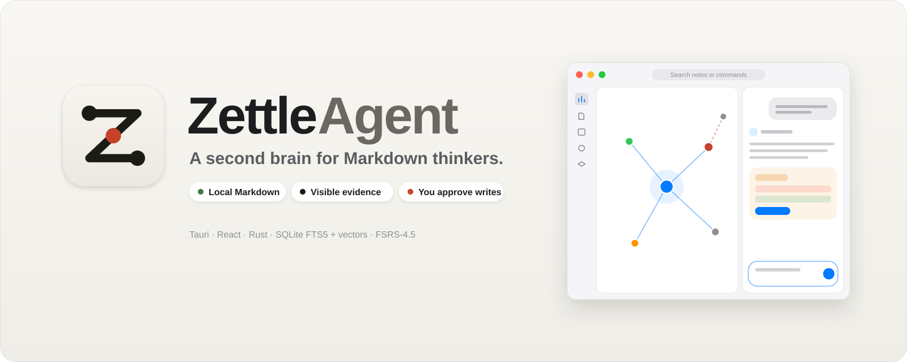
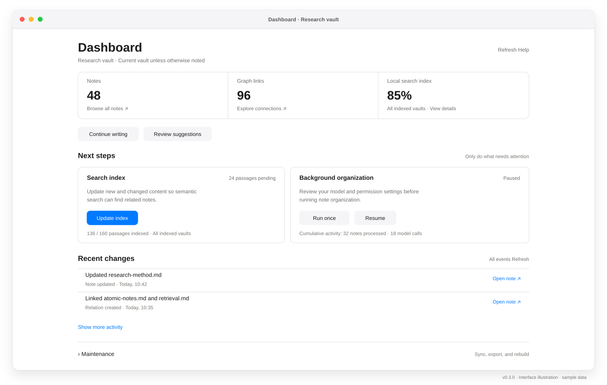
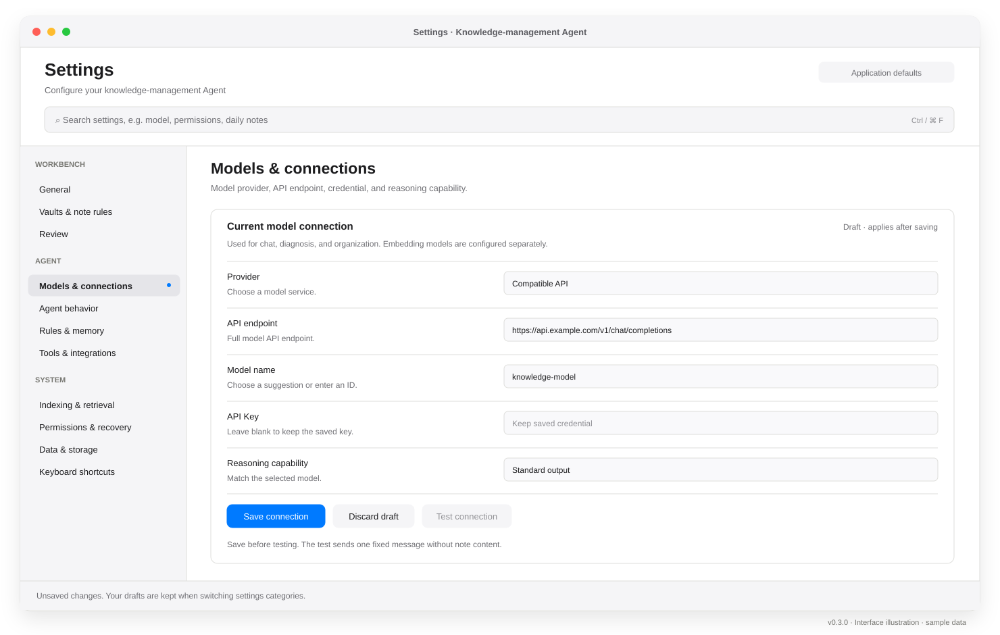
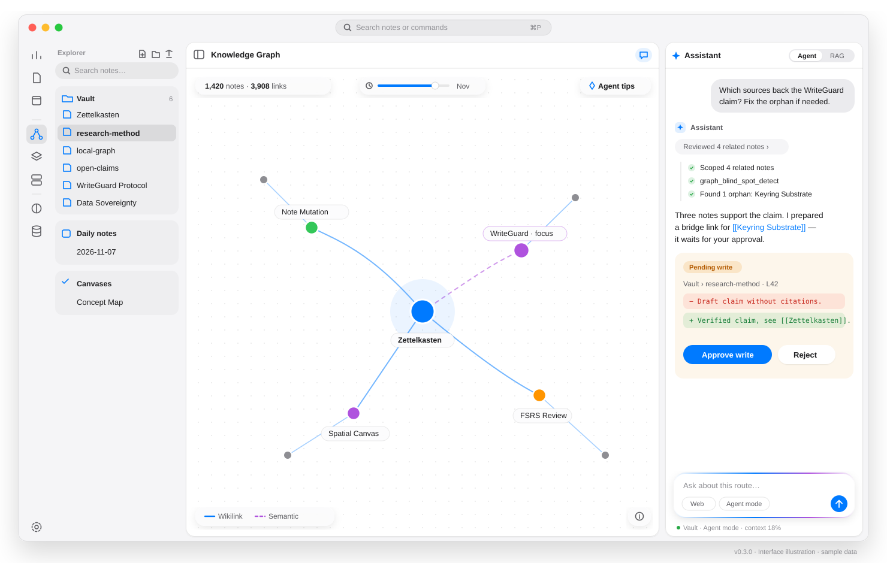
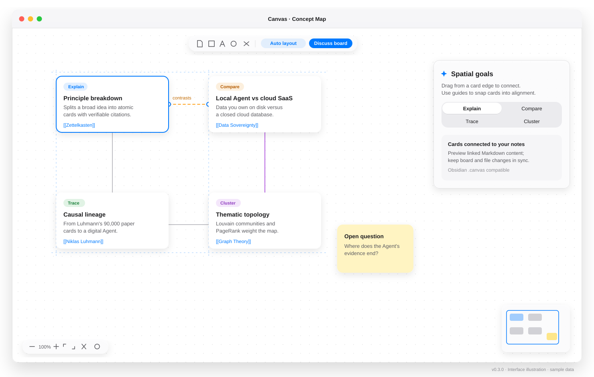
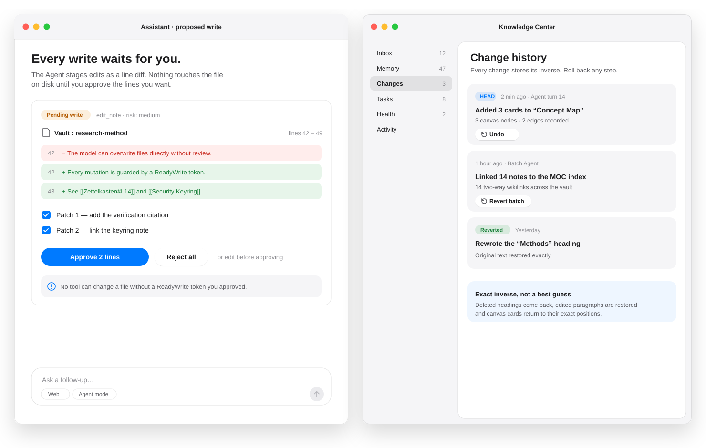
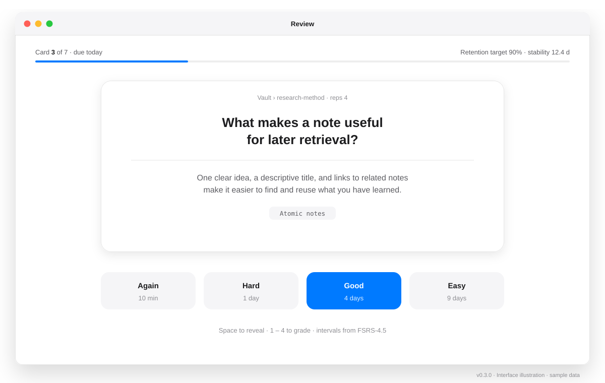

# ZettelAgent

### ナレッジ管理のためのローカルファースト AI Agent / IDE

Markdown で書き、関連するアイデアを探し、Agent の変更を確認する。

ZettelAgent はノート、検索、ナレッジグラフ、無限キャンバス、間隔反復を一つのデスクトップワークベンチにまとめます。ローカルまたはクラウドの言語モデルに接続して、対話、診断、ノート整理を行えます。

[](https://github.com/Poetrynan/ZettleAgent/releases)


[](https://github.com/Poetrynan/ZettleAgent/blob/master/LICENSE)

[English](README.md) · [中文](README_CN.md) · **日本語** · [한국어](README_KR.md)

[Releases](https://github.com/Poetrynan/ZettleAgent/releases) · [Website](https://poetrynan.github.io/zettelagent.org/) · [v0.3.0 Release Notes](.github/release-notes/v0.3.0.md)

[今回の更新](#new) · [主な機能](#features) · [画面ガイド](#showcase) · [クイックスタート](#start) · [ソースからビルド](#build) · [対応プラットフォーム](#platforms) · [貢献](#contributing)

<a id="new"></a>

## 今回の更新 — v0.3.0

v0.3.0 では、タスク中心の Dashboard、検索可能な 11 の設定カテゴリ、キャンバスの接続とスナップ、中国語検索、履歴読み取りと安全な取り消しを改善しました。

<a id="features"></a>

## 主な機能

| ワークフロー | できること |
| :--- | :--- |
| **Markdown 保管庫** | ローカルフォルダ、デイリーノート、Wiki リンク、未リンクの言及を利用できます。ノートは他のエディタでも開けます。 |
| **Dashboard** | 保管庫の件数、索引の進捗、バックグラウンド整理、最近の変更、診断を確認。保守操作は折りたたんで表示します。 |
| **Agent とナレッジセンター** | 検索した文脈で質問し、変更提案、記憶、タスク、グラフのギャップ計画を確認。外部 MCP ツールとスキルディレクトリも接続できます。 |
| **ハイブリッド検索** | FTS5、ローカルの 768 次元 Jina 埋め込み、グラフ信号、BCE リランキングを組み合わせます。簡体字・繁体字の相互検索と `.zettelignore` に対応。 |
| **キャンバスとグラフ** | ドラッグ接続とスナップ整列、説明・比較・追跡・クラスタリングの計画を利用。関連リンク、PageRank、コミュニティを調べ、Obsidian `.canvas` ファイルを扱えます。 |
| **設定ワークベンチ** | Workbench、Agent、System の 11 カテゴリを検索。保存済み接続のテスト、カテゴリ間の下書き保持、ルール・権限・検索・保存先の設定に対応。 |
| **間隔反復** | FSRS-4.5 の復習計画と、目標保持率、日次上限、最大間隔を設定できます。 |
| **変更確認と復元** | 対応する Agent の変更には権限チェックが適用され、プレビューや履歴を確認できます。取り消しは後続の編集を検査し、競合時には復元を拒否する場合があります。 |

### ローカルデータとモデル接続

ノート、検索データベース、同梱の埋め込み・OCR 処理はローカルで動作します。AI 対話と整理にはモデル接続が必要です。クラウドを選ぶと、リクエストと含まれるノートの文脈がそのサービスに送られます。ローカルモデルに接続すれば、そのリクエストを端末内に保てます。カスタムの外部埋め込みサービスにも、索引と検索に使用するテキストが送られます。外部ツールは各接続先を利用します。

API キーは利用可能な OS の資格情報ストアに保存します。利用できない場合は、設定に保護されていない代替保存の状態を表示します。自動整理の前に **Permissions & recovery** を確認してください。承認条件は権限モードで異なり、取り消し履歴はバックアップの代わりにはなりません。

<a id="showcase"></a>

## 画面ガイド

以下はサンプルデータで描いた SVG の画面模式図で、実際のスクリーンショットではありません。ワークフローと情報構造を示しており、テーマや OS により外観は異なります。

### 1. Dashboard：状態、次の操作、索引、最近の変更



### 2. 設定：検索、グループ別ナビゲーション、接続の下書き



### 3. ワークスペース：エクスプローラー、グラフ、Agent 対話



### 4. キャンバス：ノートカード、接続、整列ガイド



### 5. 変更確認：提案された編集と後続編集を保護する復元



### 6. 復習：想起と FSRS スケジュール



<a id="start"></a>

## クイックスタート

1. [Releases](https://github.com/Poetrynan/ZettleAgent/releases) から OS 用のパッケージをインストールします。インストール済みアプリに Node.js や Docker は不要です。
2. ローカルの Markdown フォルダを保管庫として開きます。
3. Dashboard で検索索引を更新します。同梱モデルは必要時に読み込むため、初回は時間がかかる場合があります。
4. AI 対話と整理には **Settings → Models & connections** で接続先を選び、保存してテストします。対話用 LLM は同梱していません。
5. 自動整理の前に **Agent behavior**、**Rules & memory**、**Permissions & recovery** を確認します。

索引は **768 次元**です。カスタム埋め込みサービスも同じ次元を返す必要があります。更新は未処理の内容を対象とし、全ベクトル再構築は派生ベクトルとキャッシュを削除して再生成します。外部サービスへのリクエストが再度発生するため、事前にバックグラウンド整理を停止してください。

<a id="build"></a>

## ソースからビルド

Node.js **20.19+ または 22.12+**、Rust stable、および OS に応じた Tauri のビルド依存関係が必要です。Linux の依存関係は[リリースワークフロー](.github/workflows/release.yml)を参照してください。

```bash
git clone https://github.com/Poetrynan/ZettleAgent.git
cd ZettleAgent
npm ci
npm run download-model
npm run tauri dev
```

```bash
npm test -- --maxWorkers=4
npm run build
npm run tauri build
```

本番ビルドは埋め込み、リランキング、WASM、フォント、PDF の資産をダウンロードし、オフライン資源を同梱します。ソースビルドの準備にはネット接続が必要です。Tauri は初回に `src-tauri/gen/` を生成します。

<a id="platforms"></a>

## 対応プラットフォーム

リリースフローの対象は以下です。実際のパッケージと容量は各 Release の添付資産を参照してください。

| OS | アーキテクチャ | パッケージ |
| :--- | :--- | :--- |
| Windows | x64 | `.exe`, `.msi` |
| macOS | Apple Silicon / Intel | `.dmg` |
| Linux | x64 | `.AppImage`, `.deb` |

<a id="contributing"></a>

## 貢献

貢献方法は [CONTRIBUTING.md](CONTRIBUTING.md) を参照。問題報告にはバージョン、OS、再現手順、秘密情報を除いたログを添えてください。

Tauri、React、Rust、SQLite / sqlite-vec、Jina 埋め込み、BCE リランキング、FSRS を使用し、Zettelkasten とローカル Markdown のワークフローを参考にしています。

[Apache License 2.0](LICENSE) で公開しています。
