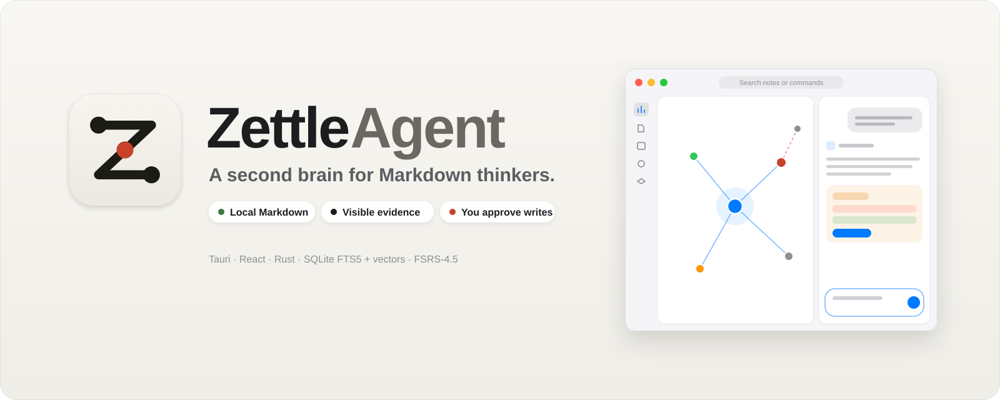
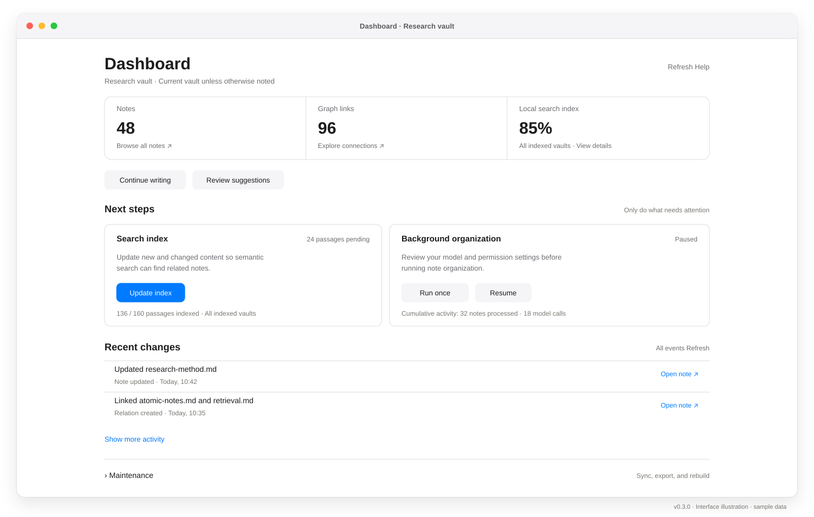
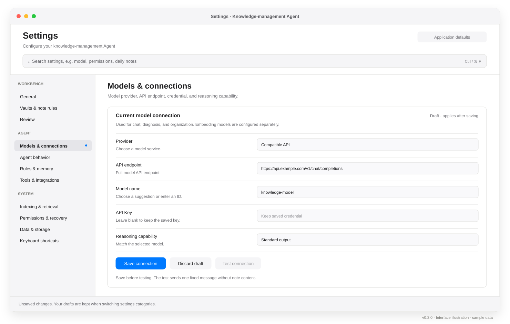
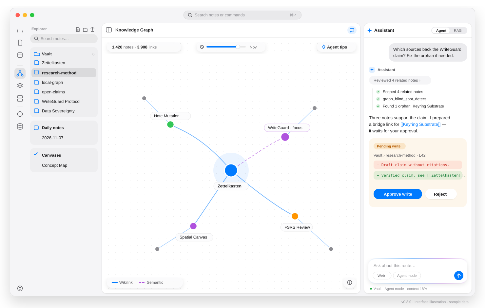
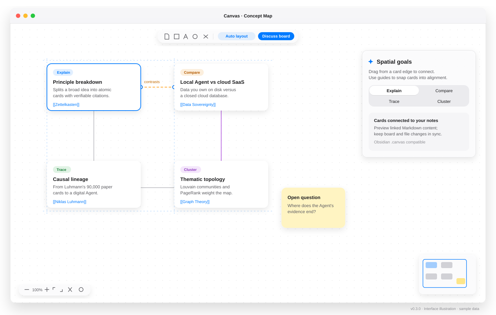
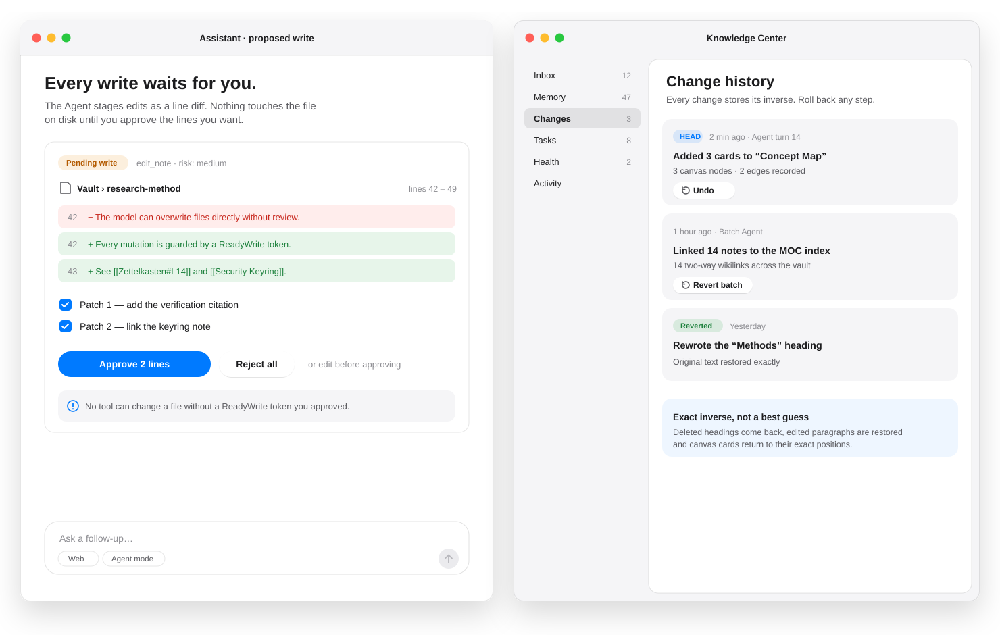
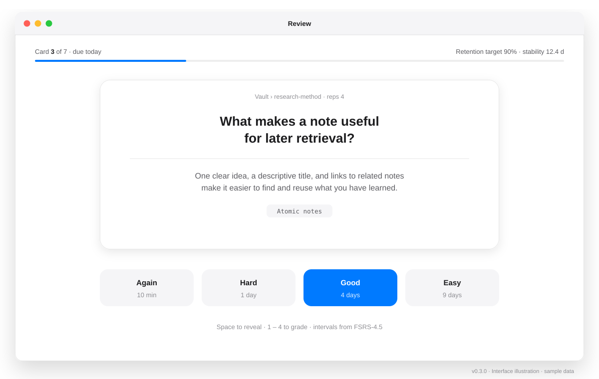

# ZettelAgent

### 지식 관리를 위한 로컬 우선 AI Agent / IDE

Markdown으로 쓰고, 관련 아이디어를 찾고, Agent의 변경을 검토하세요.

ZettelAgent는 노트, 검색, 지식 그래프, 무한 캔버스와 간격 반복을 하나의 데스크톱 작업 공간에 모았습니다. 로컬 또는 클라우드 언어 모델을 연결해 대화, 지식 진단과 노트 정리를 수행합니다.

[](https://github.com/Poetrynan/ZettleAgent/releases)


[](https://github.com/Poetrynan/ZettleAgent/blob/master/LICENSE)

[English](README.md) · [中文](README_CN.md) · [日本語](README_JP.md) · **한국어**

[Releases](https://github.com/Poetrynan/ZettleAgent/releases) · [Website](https://poetrynan.github.io/zettelagent.org/) · [v0.3.0 Release Notes](.github/release-notes/v0.3.0.md)

[이번 업데이트](#new) · [주요 기능](#features) · [화면 안내](#showcase) · [빠른 시작](#start) · [소스에서 빌드](#build) · [대상 플랫폼](#platforms) · [기여](#contributing)

<a id="new"></a>

## 이번 업데이트 — v0.3.0

v0.3.0은 작업 중심 Dashboard, 검색 가능한 11개 설정 섹션, 캔버스 연결과 스냅, 중국어 검색, 노트 이력 및 안전한 실행 취소를 개선합니다.

<a id="features"></a>

## 주요 기능

| 작업 흐름 | 할 수 있는 일 |
| :--- | :--- |
| **Markdown 보관함** | 로컬 폴더, 일일 노트, 위키 링크와 연결되지 않은 언급을 활용합니다. 노트 파일은 다른 편집기에서도 열 수 있습니다. |
| **Dashboard** | 보관함 수치, 색인 진행, 백그라운드 정리, 최근 변경과 진단을 확인합니다. 유지보수 작업은 접어서 표시합니다. |
| **Agent와 지식 센터** | 검색된 문맥으로 질문하고 변경 제안, 기억, 작업과 그래프 공백 계획을 검토합니다. 외부 MCP 도구와 스킬 디렉터리를 연결할 수 있습니다. |
| **하이브리드 검색** | FTS5, 로컬 768차원 Jina 임베딩, 그래프 신호와 BCE 재순위를 결합합니다. 중국어 간체·번체 상호 검색과 `.zettelignore` 제외 규칙을 지원합니다. |
| **캔버스와 그래프** | 드래그 연결과 스냅 정렬, 설명·비교·추적·군집화 계획을 사용합니다. 링크, PageRank와 커뮤니티를 탐색하고 Obsidian `.canvas` 파일을 다룹니다. |
| **설정 작업 공간** | Workbench, Agent, System의 11개 섹션을 검색합니다. 저장된 모델 연결 테스트, 섹션 간 초안 유지, 규칙·권한·검색·저장소 설정을 제공합니다. |
| **간격 반복** | FSRS-4.5 복습 일정과 목표 유지율, 일일 한도, 최대 간격을 설정합니다. |
| **변경 검토와 복구** | 지원되는 Agent 변경에는 권한 검사가 적용되며 미리보기와 변경 이력을 확인할 수 있습니다. 실행 취소는 이후 편집을 검사하고 충돌 시 복원을 거부할 수 있습니다. |

### 로컬 데이터와 모델 연결

노트, 검색 데이터베이스와 내장 임베딩·OCR 처리는 로컬에 유지됩니다. AI 대화와 정리에는 모델 연결이 필요합니다. 클라우드를 선택하면 요청과 포함된 노트 문맥이 해당 서비스로 전송됩니다. 로컬 모델 서비스에 연결하면 이 요청을 기기 안에 유지할 수 있습니다. 사용자 지정 원격 임베딩 서비스에도 색인과 검색에 사용하는 텍스트가 전송됩니다. 외부 도구는 각자의 연결을 사용합니다.

API 키는 사용 가능한 OS 자격 증명 저장소에 저장합니다. 저장소를 사용할 수 없으면 설정에서 보호되지 않은 대체 저장 상태를 알립니다. 자동 정리 전에 **Permissions & recovery**를 확인하세요. 승인 요구는 권한 모드에 따라 달라집니다. 실행 취소 이력은 백업을 대신하지 않습니다.

<a id="showcase"></a>

## 화면 안내

아래 SVG는 예시 데이터로 그린 화면 설명도이며 실제 스크린샷이 아닙니다. 작업 흐름과 정보 구조를 보여 주며 테마와 플랫폼에 따라 외관이 달라질 수 있습니다.

### 1. Dashboard: 상태, 다음 작업, 색인과 최근 변경



### 2. 설정: 검색, 그룹 탐색과 명시적으로 저장하는 연결 초안



### 3. 작업 공간: 탐색기, 그래프와 Agent 대화



### 4. 캔버스: 노트 카드, 연결과 정렬 안내선



### 5. 변경 검토: 편집 제안과 이후 편집을 보호하는 복구



### 6. 복습: 능동 회상과 FSRS 일정



<a id="start"></a>

## 빠른 시작

1. [Releases](https://github.com/Poetrynan/ZettleAgent/releases)에서 플랫폼에 맞는 패키지를 설치합니다. 설치된 앱에는 Node.js나 Docker가 필요하지 않습니다.
2. 로컬 Markdown 폴더를 보관함으로 엽니다.
3. Dashboard에서 검색 색인을 업데이트합니다. 내장 모델은 필요할 때 로드하므로 처음에는 시간이 걸릴 수 있습니다.
4. AI 대화와 정리는 **Settings → Models & connections**에서 서비스를 선택하고 연결을 저장한 뒤 테스트합니다. 대화용 LLM은 앱에 포함되지 않습니다.
5. 자동 정리 전에 **Agent behavior**, **Rules & memory**, **Permissions & recovery**를 확인합니다.

벡터 색인은 **768차원**을 사용합니다. 사용자 지정 임베딩 서비스도 같은 차원을 반환해야 합니다. 업데이트는 대기 중인 내용을 처리하고, 전체 벡터 재구축은 파생 벡터와 캐시를 지운 뒤 다시 생성합니다. 원격 서비스 요청이 다시 발생하므로 전체 재구축 전에 백그라운드 정리를 일시 정지하세요.

<a id="build"></a>

## 소스에서 빌드

Node.js **20.19+ 또는 22.12+**, Rust stable과 플랫폼별 Tauri 빌드 의존성이 필요합니다. Linux 의존성은 [릴리스 워크플로](.github/workflows/release.yml)에 나와 있습니다.

```bash
git clone https://github.com/Poetrynan/ZettleAgent.git
cd ZettleAgent
npm ci
npm run download-model
npm run tauri dev
```

```bash
npm test -- --maxWorkers=4
npm run build
npm run tauri build
```

프로덕션 빌드는 임베딩, 재순위, WASM, 글꼴과 PDF 리소스를 다운로드하고 오프라인 리소스를 패키징합니다. 소스 빌드의 준비 단계에는 네트워크가 필요합니다. Tauri는 처음 실행할 때 `src-tauri/gen/`을 생성합니다.

<a id="platforms"></a>

## 대상 플랫폼

릴리스 워크플로의 대상 플랫폼은 다음과 같습니다. 실제 패키지와 용량은 각 Release의 첨부 파일을 확인하세요.

| 플랫폼 | 아키텍처 | 패키지 |
| :--- | :--- | :--- |
| Windows | x64 | `.exe`, `.msi` |
| macOS | Apple Silicon / Intel | `.dmg` |
| Linux | x64 | `.AppImage`, `.deb` |

<a id="contributing"></a>

## 기여

기여 방법은 [CONTRIBUTING.md](CONTRIBUTING.md)를 참고하세요. 문제를 보고할 때 버전, 플랫폼, 재현 단계와 비밀 정보를 제거한 로그를 포함해 주세요.

Tauri, React, Rust, SQLite / sqlite-vec, Jina 임베딩, BCE 재순위와 FSRS로 구축했으며 Zettelkasten과 로컬 Markdown 작업 흐름에서 영감을 받았습니다.

[Apache License 2.0](LICENSE)에 따라 배포합니다.
